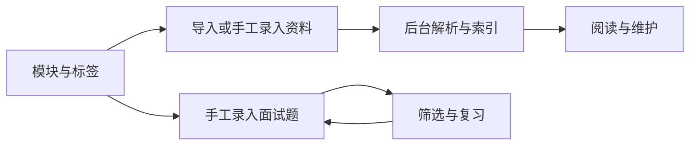

# 个人 AI 工作台 V1 产品框架

> 与 2026-10-26 简化范围一致；详细规则以 [PRD](PRD-v1.md) 为准。

## 页面框架

```text
AI 工作台
├── 首页：资料数、面试题数、最近内容
├── AI 面经：新建、编辑、删除、筛选复习
├── 资料库：手工资料、导入 Markdown、阅读、索引、归档、删除
├── 标签管理：创建、编辑、删除
└── 模块管理：创建、查看、删除
```

## 业务流程



资料与题目共享分类体系，但不经过 AI 草稿审核环节。用户直接维护正式资料与题目。

## 数据关系

- 模块与资料、题目是一对多关系，删除模块只解除分类。
- 资料、题目与标签为多对多关系，删除标签只解除标签关系。
- 资料具有索引任务和内容片段，删除资料同步清理相应数据。
- 上传文件副本位于本地目录，业务正文位于数据库，二者都应纳入备份。

## 功能边界

资料库和 AI 面经分别提供内容搜索；不设全局搜索入口。
AI 草稿已取消，AI 查询暂不开放。V1 不引入容器化、数据库迁移框架或演示媒体生成工具。
